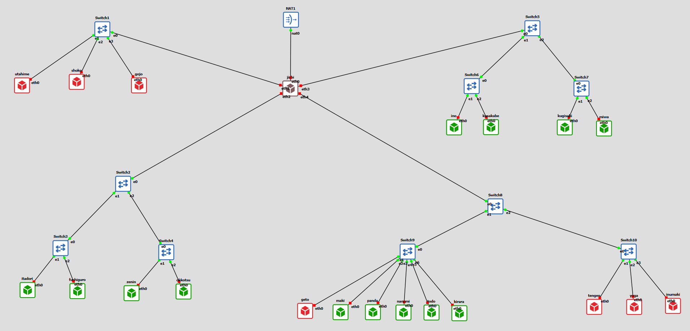

1. topologi
   

2. Network configuration <br>
   jichi
   ```bash
    auto eth0
    iface eth0 inet dhcp
        up sysctl -w net.ipv4.ip_forward=1
        up iptables -t nat -A POSTROUTING -o eth0 -j MASQUERADE
        up bash /root/script.sh

    auto eth1
    iface eth1 inet static
        address 10.92.1.1
        netmask 255.255.255.0

    auto eth2
    iface eth2 inet static
        address 10.92.2.1
        netmask 255.255.255.0

    auto eth3
    iface eth3 inet static
        address 10.92.3.1
        netmask 255.255.255.0

    auto eth4
    iface eth4 inet static
        address 10.92.4.1
        netmask 255.255.255.0  
    ```
    utahime
    ```bash
    auto eth0
    iface eth0 inet static
        address 10.92.1.2
        netmask 255.255.255.0
        gateway 10.92.1.1
        up bash /root/script.sh
    ```
    shoko
    ```bash
    auto eth0
    iface eth0 inet static
        address 10.92.1.3
        netmask 255.255.255.0
        gateway 10.92.1.1
        up bash /root/script.sh
    ```
    gojo
    ```bash
    auto eth0
    iface eth0 inet static
        address 10.92.1.4
        netmask 255.255.255.0
        gateway 10.92.1.1
        up bash /root/script.sh
    ```
    tengen
    ```bash
    auto eth0
    iface eth0 inet static
        address 10.92.4.2
        netmask 255.255.255.0
        gateway 10.92.4.1
        up bash /root/script.sh
    ```
    geto
    ```bash
    auto eth0
    iface eth0 inet static
        address 10.92.4.3
        netmask 255.255.255.0
        gateway 10.92.4.1
        up bash /root/script.sh
    ```
    maki
    ```bash
    auto eth0
    iface eth0 inet static
        address 10.92.4.4
        netmask 255.255.255.0
        gateway 10.92.4.1
        up bash /root/script.sh
    ```
    panda
    ```bash
    auto eth0
    iface eth0 inet static
        address 10.92.4.5
        netmask 255.255.255.0
        gateway 10.92.4.1
        up bash /root/script.sh
    ```
    nanami
    ```bash
    auto eth0
    iface eth0 inet static
        address 10.92.4.6
        netmask 255.255.255.0
        gateway 10.92.4.1
        up bash /root/script.sh
    ```
    todo
    ```bash
    auto eth0
    iface eth0 inet static
        address 10.92.4.7
        netmask 255.255.255.0
        gateway 10.92.4.1
        up bash /root/script.sh
    ```
    kirara
    ```bash
    auto eth0
    iface eth0 inet static
        address 10.92.4.9
        netmask 255.255.255.0
        gateway 10.92.4.1
        up bash /root/script.sh
    ```
    yaga
    ```bash
    auto eth0
    iface eth0 inet static
        address 10.92.4.8
        netmask 255.255.255.0
        gateway 10.92.4.1
        up bash /root/script.sh
    ```
    inumaki
    ```bash
    auto eth0
    iface eth0 inet static
        address 10.92.4.11
        netmask 255.255.255.0
        gateway 10.92.4.1
        up bash /root/script.sh
    ```
    all client alpinet (itadori, fushiguro, zenin, okkotsu, ino, kusakabe, miwa, kugisaki)
    ```bash
    auto eth0
    iface eth0 inet dhcp
    ```

2. bikin configurasi script.sh <br>
   jichi
   ```bash
   nano /root/script.sh
   ```
   ```bash
   #!/bin/bash

    # Setup DNS resolver awal
    echo "nameserver 192.168.122.1" > /etc/resolv.conf

    # Mengaktifkan Kernel IP Forwarding
    sysctl -w net.ipv4.ip_forward=1

    # Mengaktifkan Source NAT (iptables MASQUERADE) via eth0
    iptables -t nat -A POSTROUTING -o eth0 -j MASQUERADE

    # Restart antarmuka jaringan
    service networking restart 2>/dev/null || true
    ```
    beri izin lalu jalankan
    ```bash
    chmod +x /root/script.sh
    ```
    ```bash
    bash /root/script.sh
    ```

    untuk semua debian (utahime, shoko, gojo, tengen, geto, maki, panda, nanami, todo, kirara, yaga, inumaki)
    ```bash
    nano /root/script.sh
    ```
    ```bash
    #!/bin/bash

    # Setup DNS resolver awal
    echo "nameserver 192.168.122.1" > /etc/resolv.conf

    # Update repository
    apt-get update
    ```
    beri izin lalu jalankan
    ```bash
    chmod +x /root/script.sh
    ```
    ```bash
    bash /root/script.sh
    ```

3. pengujian <br>
   di jichi
   ```bash
   ping -c 3 8.8.8.8
   ```
   di debinet
   ```bash
   ping -c 3 10.92.1.1
   ```
   ```bash
   ping -c 3 10.92.4.1
   ```
   ```bash
   ping -c 3 8.8.8.8
   ```
   ```bash
   ping -c 3 google.com
   ```
   