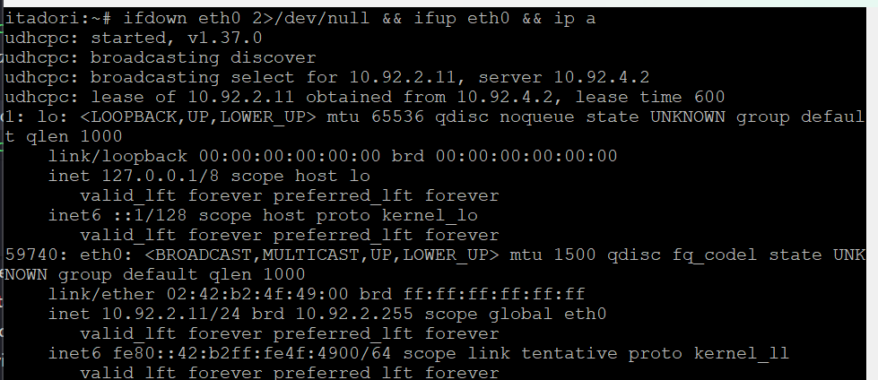
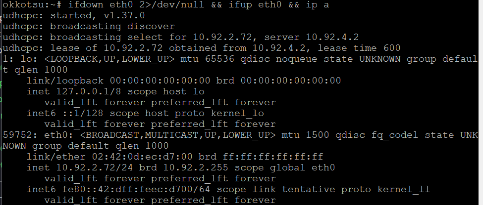
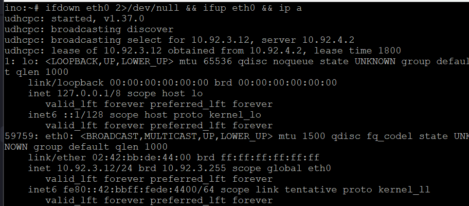
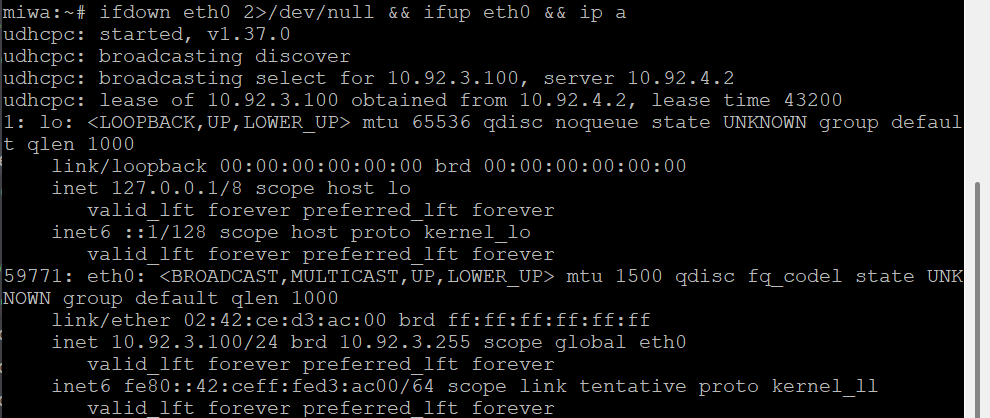
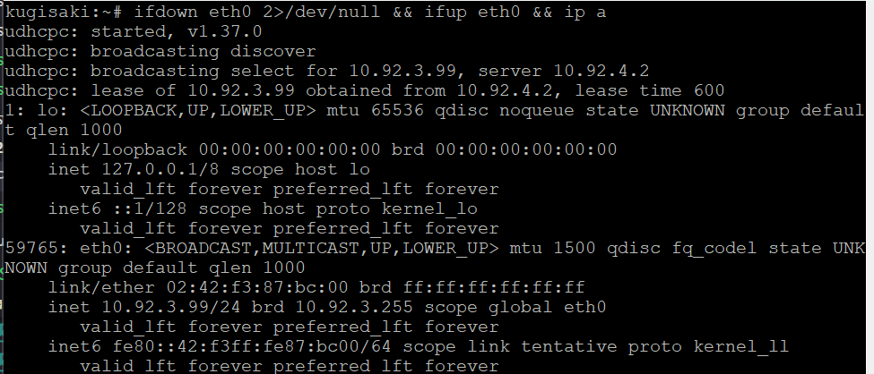

1. buat auto start di tengen
   ```bash
   echo 'service isc-dhcp-server status | grep -q "running" || bash /root/script.sh' >> /root/.bashrc
   ```
   pastikan service enable di init system
   ```bash
   update-rc.d isc-dhcp-server enable 2>/dev/null || systemctl enable isc-dhcp-server 2>/dev/null || true
   ```

2. buat konfigurasi auto start di jichi
   ```bash
   echo 'ps aux | grep -v grep | grep -q dhcrelay || dhcrelay -i eth2 -i eth3 -i eth4 10.92.4.2' >> /root/.bashrc
   ```
   jalanin tes eksekusi lokal
   ```bash
   ps aux | grep dhcrelay
   ```

3. lakukan simulasi reboot di tengen
   ```bash
   service isc-dhcp-server restart
    ```
    ```bash
    service isc-dhcp-server status
   ```
   jichi
   ```bash
    pkill dhcrelay
    dhcrelay -i eth2 -i eth3 -i eth4 10.92.4.2
    ps aux | grep dhcrelay
    ```

4. verifikasi setelah reboot <br>
   tengen
   ```bash
   service isc-dhcp-server status
   ```
    
   jichi
   ```bash
   ps aux | grep dhcrelay
   ```
    

5. Buktikan di node lain <br>
   itadori - harus 10.92.2.11
   ```bash
   ifdown eth0 2>/dev/null && ifup eth0 && ip a
   ```
   
   okkotsu - harus 10.92.2.72
   ```bash
   ifdown eth0 2>/dev/null && ifup eth0 && ip a
   ```
   
   ino - harus 10.92.3.12
   ```bash
   ifdown eth0 2>/dev/null && ifup eth0 && ip a
   ```
   
   miwa - harus 10.92.3.100
   ```bash
   ifdown eth0 2>/dev/null && ifup eth0 && ip a
   ```
   
   kugisaki - harus 10.92.3.99
   ```bash
   ifdown eth0 2>/dev/null && ifup eth0 && ip a
   ```
   
