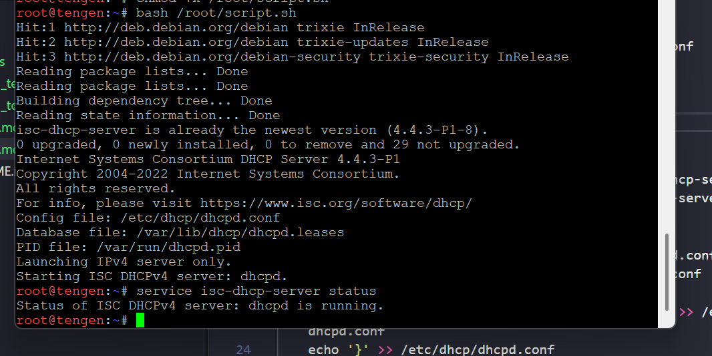

1. update script tengen
   ```bash
   nano /root/script.sh
   ```
   ```bash
    #!/bin/bash

    # Setup DNS resolver sementara
    echo "nameserver 192.168.122.1" > /etc/resolv.conf

    # Update & install isc-dhcp-server
    apt-get update
    apt-get install isc-dhcp-server -y

    # Atur interface listening
    echo 'INTERFACESv4="eth0"' > /etc/default/isc-dhcp-server
    echo 'INTERFACESv6=""' >> /etc/default/isc-dhcp-server

    # Atur konfigurasi dhcpd.conf
    echo 'default-lease-time 600;' > /etc/dhcp/dhcpd.conf
    echo 'max-lease-time 3600;' >> /etc/dhcp/dhcpd.conf
    echo '' >> /etc/dhcp/dhcpd.conf
    echo 'subnet 10.92.4.0 netmask 255.255.255.0 {' >> /etc/dhcp/dhcpd.conf
    echo '}' >> /etc/dhcp/dhcpd.conf
    echo '' >> /etc/dhcp/dhcpd.conf
    echo 'subnet 10.92.2.0 netmask 255.255.255.0 {' >> /etc/dhcp/dhcpd.conf
    echo '    option routers 10.92.2.1;' >> /etc/dhcp/dhcpd.conf
    echo '    option subnet-mask 255.255.255.0;' >> /etc/dhcp/dhcpd.conf
    echo '    option domain-name-servers 192.168.122.1;' >> /etc/dhcp/dhcpd.conf
    echo '}' >> /etc/dhcp/dhcpd.conf
    echo '' >> /etc/dhcp/dhcpd.conf
    echo 'subnet 10.92.3.0 netmask 255.255.255.0 {' >> /etc/dhcp/dhcpd.conf
    echo '    option routers 10.92.3.1;' >> /etc/dhcp/dhcpd.conf
    echo '    option subnet-mask 255.255.255.0;' >> /etc/dhcp/dhcpd.conf
    echo '    option domain-name-servers 192.168.122.1;' >> /etc/dhcp/dhcpd.conf
    echo '}' >> /etc/dhcp/dhcpd.conf

    # Validasi sintaks
    dhcpd -t

    # Restart service
    service isc-dhcp-server restart
    ```
    beri izin dan jalankan
    ```bash
    chmod +x /root/script.sh
    ```
    ```bash
    bash /root/script.sh
    ```
    test apakah berhasil jalan
    ```bash
    service isc-dhcp-server status
    ```
    